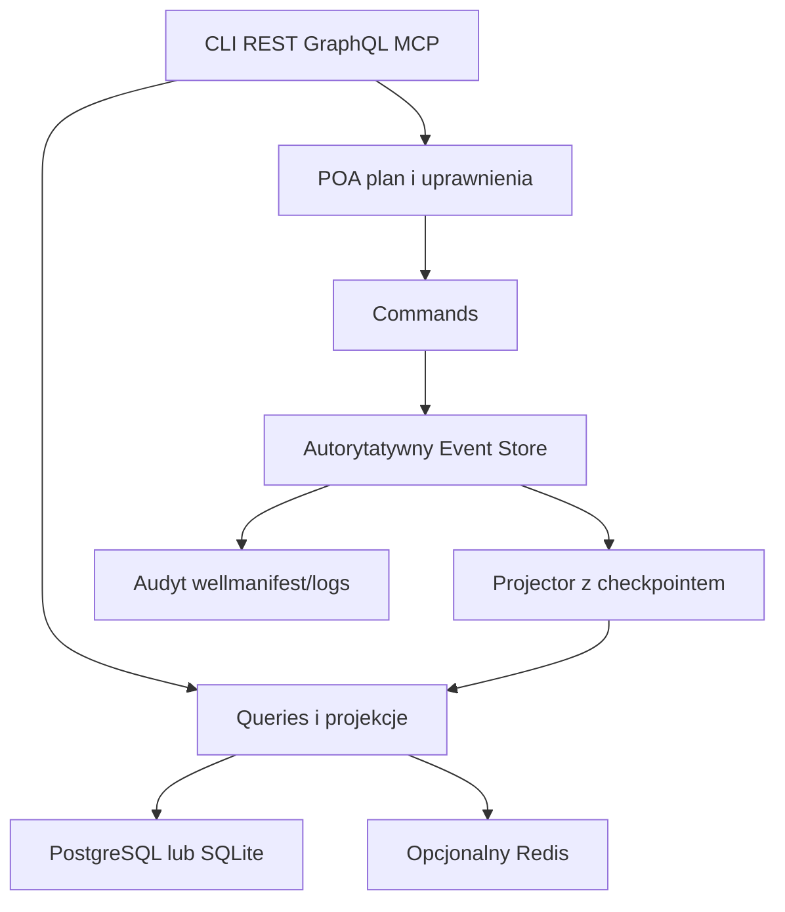

# wellmanifest/data-plane

**Propozycja repozytorium standardu · 0.2.0 · 2026-10-09**

Obowiązkowe POA + CQRS + Event Sourcing. Jedna warstwa operacji dla CLI/shell, REST, GraphQL i MCP. PostgreSQL, SQLite i Redis mają jawne role. Priorytety: małe zużycie RAM, stopniowa migracja i ponowne użycie danych.

Repo zawiera standard, schematy, kontrakty, SQL/Protobuf, działający model conformance ES na SQLite, testy, Makefile, Dockerfile i CI. Docelowa nazwa publikacji: `wellmanifest/data-plane`. To przygotowane repozytorium standardu; produkcyjny gateway i publikacja w organizacji pozostają osobnymi działaniami.



Commands zapisują fakty, queries czytają projekcje, a plan nie nadaje uprawnień. Każdy stream ma jednego autorytatywnego writera. Adaptery współdzielą katalog i autoryzację.

| Profil | Zapis autorytatywny | Zastosowanie |
|---|---|---|
| `sqlite-embedded-es-v1` | SQLite | Minimalny RAM; ES, projekcje i outbox w jednym pliku |
| `hybrid-sqlite-postgres-es-v1` | Wskazany per stream: SQLite albo PostgreSQL | Stopniowa refaktoryzacja i relay |
| `postgres-es-v1` | PostgreSQL | Współpraca wielu hostów; opcjonalne projekcje SQLite |
| `redis-cache-v1` | Żaden | Opcjonalny mały cache, jeśli uzasadnia go pomiar |
| `low-ram-v1` | Dziedziczy profil magazynu | Domyślne limity zasobów |

SQLite może pozostać lokalną projekcją, archiwum lub właścicielem wyodrębnionych streamów. Redis domyślnie jest wyłączony. Współistnienie baz nie oznacza niezależnego zapisywania tego samego stanu w obu.

## Dokumenty

- `STANDARD.md`: wymagania normatywne.
- `spec/POA_CQRS_ES.md`: event store, checkpointy, snapshoty i replay.
- `spec/LOGS_ADOPTION.md`: zgodność z wellmanifest/logs 0.5.0.
- `spec/SQLITE_COEXISTENCE.md`: capture, relay i zmiana authority.
- `spec/LOW_RAM.md`: budżet, konfiguracja i pomiar RAM.
- `spec/GRAPHQL_DATA_REUSE.md`: wiele baz, batching i wspólne projekcje.
- `LLM_REFACTORING.md`: zadania dla agenta wdrażającego.
- `docs/IMPLEMENTATION_STATUS.md`: granice implementacji i testów.
- `docs/README.md`: indeks dokumentów zgodnych z wellmanifest/docs, report i logs.

## Conformance

```bash
python3 -m venv .venv
.venv/bin/pip install -r requirements-qa.txt
make check PYTHON=.venv/bin/python
make test PYTHON=.venv/bin/python
make demo PYTHON=.venv/bin/python
make upstream-check PYTHON=.venv/bin/python
docker compose run --rm conformance
```

Demo zapisuje ES w SQLite, replikuje idempotentnie do drugiej bazy i odtwarza projekcję. To model protokołu, nie migrator dowolnej aplikacji. Upstream-check pobiera dokładny commit logs i waliduje nasze przykłady jego checkerem. Możesz wskazać istniejący checkout przez `WELLLOGS_ROOT`.

`upstream.lock.json` przypina logs do `cd9d9558e09b9135ef92712096eb951fd524aa75`, VERSION 0.5.0, wraz z hashami. README upstream opisuje starszy etap; podstawą adopcji są aktualne kontrakty i architektura.

Wersja 0.2 zmienia semantykę zapisu: ES jest źródłem stanu, tabele bieżące są projekcjami. Nowe URI `/v2` nie zmieniają znaczenia historycznych `/v1`. Zobacz `CHANGELOG.md`, `SOURCES.md` i `qa/REPORT.md`.
